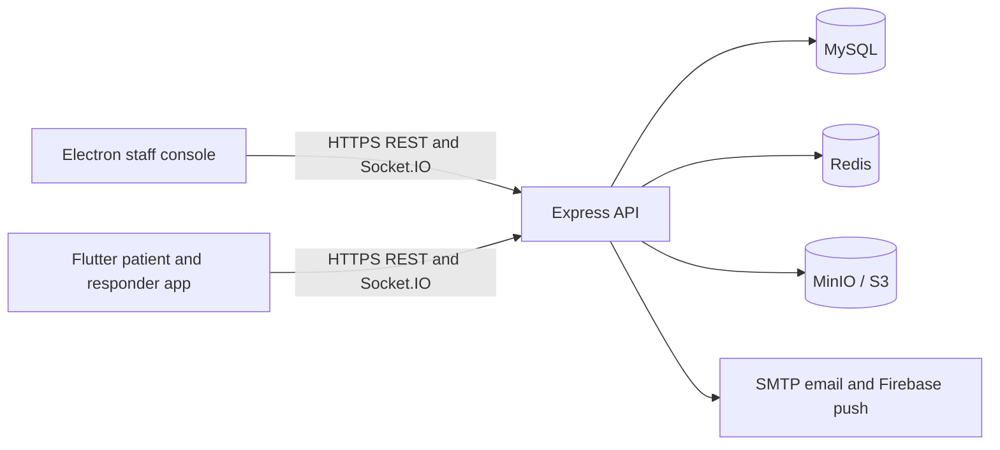

# HealthLink — codebase overview

Reviewed against this checkout on 2026-11-15. This is an architectural walkthrough with targeted source inspection, not an exhaustive audit or proof of production readiness. Start development with [AGENTS.md](AGENTS.md); follow its module guides for detailed rules and commands.

## What it is

HealthLink is a university campus clinic management system. It connects patients, clinic staff and emergency responders around appointments, clinical records, medicines and emergency incidents. The project guidance identifies Pangasinan State University as its setting.

The repository is named `AbsoluteDogshit`. Branding is currently mixed: the desktop package and most technical guides use **Valetudo HealthLink**, while the mobile app title, its smoke test and the root README heading use **LeoVital HealthLink**. These are names within this codebase, not separate applications.

## Who uses it and what they do

| User | Main workflows |
|---|---|
| Students, faculty and non-teaching staff | Sign in, manage their profile and consent, book/cancel consultations, track a queue ticket, display a QR health pass, retrieve documents and send SOS alerts. |
| Nurses | Check in booked patients or walk-ins, record triage/vitals, manage the clinic queue and medicine inventory, and view permitted analytics. |
| Doctors and dentists | Consult assigned patients, review history, finalize electronic medical records, issue prescriptions and clearances, and maintain dental charts for dental encounters. |
| Emergency responders | Receive alerts, view locations, acknowledge/dispatch/close incidents, and participate in the incident workflow. Clinic-reviewed responder appointments authorize trained campus volunteers and response staff. |
| Administrators | Manage accounts, roles and grants; review audits, incidents and system health; access permitted database tools. Super Admins also manage server policy and supervised restart. |

Accounts can have multiple roles. Admin grants and analytics scopes further restrict access. UI navigation reflects access, while the server enforces it.

## How the system is built

This monorepo has three separately installed applications, with no npm workspaces or root run scripts. Architecturally, the backend is a modular monolith: one API process with feature routers and domain services sharing MySQL.

| Part | Implementation and responsibility |
|---|---|
| [server/](server/AGENTS.md) | Node ESM, Express 5, mysql2 and Socket.IO. Owns business rules, authorization, transactions, migrations, documents and background jobs. REST and realtime share port 5000 by default. |
| [desktop/](desktop/AGENTS.md) | Electron 44, React 19, TypeScript and Vite 6. Windows staff console with role workspaces, printing, QR intake and encrypted local SQLite storage. A limited preload bridge connects the renderer to native features. |
| [mobile/](mobile/AGENTS.md) | Flutter/Dart patient and responder app, primarily Android. Uses secure storage, geolocation, QR display, realtime events and Firebase push. The Account settings gear opens appearance preferences shared with desktop and the password-change form. |
| [Local infrastructure](docker-compose.yml) | MySQL 8 for records; Redis 7 for cache, session revocation and other guards; MinIO for generated PDFs, signatures and attachments. Compose binds service ports to loopback. |

## What happens during a clinic visit

1. A patient signs in, grants the required consent and books a clinician's available slot from mobile.
2. At arrival, a nurse uses QR intake or a walk-in flow, records measurements and assigns a daily queue ticket.
3. A doctor or dentist opens the assigned consultation, reviews previous records and saves the encounter. Shared domain code validates encounter text, vitals and dental data and completes the appointment transaction.
4. Prescription issuance can allocate clinic stock from unexpired lots using first-expiry-first-out ordering. Deductions and linked inventory ledger entries commit together. Cancellation can restore those allocations.
5. The server generates prescription/clearance PDFs and stores them in object storage. Patients can retrieve authorized documents; QR links support verification. Failed PDF generation has a background recovery path.
6. Socket.IO events refresh queues, appointments, prescriptions and emergency views. Sensitive notifications use authorized recipient rooms.

The server also schedules appointment reminders, no-show transitions and prescription expiry. Its startup applies versioned migrations before listening, and its shutdown drains requests and jobs.

## Records, emergencies and offline behavior

[schema.sql](server/schema.sql) defines 41 base tables, plus a separate migration ledger created by the runner. The groups cover identity/roles, profiles/consent, appointments/queues, encounters/vitals/dental charts, prescriptions/inventory, emergencies/incidents, audit logs and operational policy. The schema script recreates tables; existing installations use migrations.

SOS captures a location and notifies eligible recipients through realtime and push channels. After reviewed-roster cutover, every responder needs a current clinic-approved appointment; roles and historical flags alone grant no access. [Qualification workflow](server/RESPONDER-QUALIFICATIONS.md). Non-clinical community responders receive reduced payloads without medical details and can acknowledge alerts or open their locations. Dispatch, closure and incident-report workflows require the live clinical responder tier. On Android, an eligible responder can choose On duty, Quiet or Off duty for the installation. The shared mobile roster reconciles open incidents through the API, and responders can refresh it manually while off duty. Closing an alert leads into incident documentation and an official report PDF. [Responder Hub guide](mobile/README.md#responder-hub-on-android)

Desktop offline support caches patient/encounter data and queues supported clinical changes in encrypted SQLite. Reconnection replays the signed-in account's changes through server transactions with duplicate detection and conflict handling. It does not make every feature available offline; attachment uploads require connectivity.

Mobile offline support caches emergency contacts per account and keeps call/SMS actions available. Keyed SOS requests can retry on reconnect without creating a second alert. The server acknowledges the saved alert and schedules dispatch separately. Mobile response staff can review searchable history and pending/filed reports. Report writing, encrypted private drafts and filing are desktop-only; deferred documentation remains outstanding until filed. See the [responder records guide](server/RESPONDER-RECORDS.md). Calls and SMS depend on phone service.

## Assessment and verification

See [the codebase review](CODEBASE-REVIEW.md) for maintenance priorities, security caveats and the checks performed during this walkthrough. Keep affected Markdown current under the [documentation maintenance rules](AGENTS-parts/AGENTS-02.md#documentation-maintenance--part-of-every-change).
