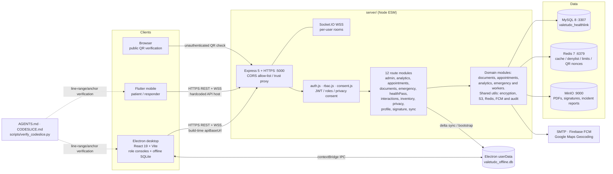

<!-- split from README.md — part 03 of 08 -->

### Emergency SOS and incident reporting

- Mobile SOS with GPS coordinates, optional Google Maps reverse geocoding, Redis-backed throttle (`ratelimit:sos:<user-or-ip>`), FCM push and Socket.IO broadcast.
- Responder access helpers provide tiered redaction, audience selection and role labels; `responderAccess.test.js` covers the behavior.
- Resolving an SOS can require an incident report. `Stage1` adds `INCIDENT_REPORTS`, pending/specific report endpoints, `IncidentReportModal.tsx`, `IncidentRecords.tsx`, PDF rendering/storage via MinIO keys, and Socket.IO events `emergency:incident_report_required` and `emergency:incident_reported`.
- Realtime events emitted server → clients include `emergency:new_alert`, `emergency:status_change`, `emergency:incident_report_required`, `emergency:incident_reported`, `responder:status_changed`, `queue:updated`, `appointment:booked`, `appointment:cancelled`, `appointment:status_changed`, and `prescription:status_changed`. Every authenticated socket joins its own `user:<id>` room for targeted delivery. The global `appointment:booked` signal carries an empty object and prompts clients to refresh through the API.

### Identity, privacy and security

- Email/password login with bcrypt and **24-hour JWTs** carrying `roles[]` and `jti`; logout/revocation uses a Redis denylist under `token:blacklist:`.
- Seeded roles: `STUDENT`, `FACULTY`, `NON_TEACHING`, `NURSE`, `DOCTOR`, `DENTIST`, `EMERGENCY_RESPONDER`, `ADMIN`. A user may hold several roles.
- Role-based access, granular admin grants, privacy-consent gating for patient PHI, `AUDIT_LOGS`, `PHI_ACCESS_LOGS`, session inactivity timeout, and rate limits for login, SOS, booking and public QR verification.
- PHI field encryption through `server/src/utils/cryptoVault.js`; secrets are validated at startup. `Stage1` adds admin health-profile encryption/decryption and updated `cryptoVault.test.js`.
- Self-signed TLS for local development, an explicit CORS allow-list, `TRUST_PROXY` handling, loopback-only infrastructure ports, and debug-only certificate overrides on mobile.

### Developer and AI-agent documentation

- `AGENTS.md` files act as token-optimized routing maps: module boundaries, ports, bootstrap order, command cheat sheets, cross-module contracts (`apiBaseUrl`, CORS, `PUBLIC_API_BASE_URL`), security invariants and “don’t read this” guards.
- `CODESLICE.md` plus `codeslice/*.md` maps break large monoliths into line-range slices with anchors, API surfaces, state fields and key-line descriptions:
  - `DT-01`–`DT-13` for desktop consoles, incident components, `App.tsx` and Electron main.
  - `MB-01`–`MB-07` for mobile screens and `EmergencyAlertService`.
- `scripts/verify_codeslice.py` mechanically checks that slice ranges are in bounds, ascending and non-overlapping, and that each anchor literally appears inside its declared source window.

---

## 3. Architecture

