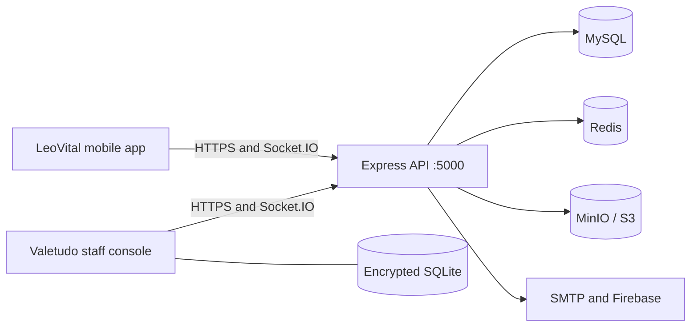

<div align="center">


# 🩺 Valetudo HealthLink

**Campus clinic management for Pangasinan State University**

[](desktop/README.md)
[](mobile/README.md)
[](BACKEND-STUDY-GUIDE.md)
[](LICENSE)

[✨ Features](#-key-features) · [🏗️ Architecture](#-architecture) · [🚀 Getting started](#-getting-started) · [📡 API](#-api-endpoints) · [🧪 Testing](#-testing)

</div>

---

## 📖 Overview

**Valetudo HealthLink** connects students and employees with clinic staff and emergency responders. Patients and responders use the **LeoVital HealthLink** Flutter app. Staff use the Electron console for care and administration.

## ✨ Key features

| Area | Workflow |
| --- | --- |
| 📅 **Patient portal** | Book a consultation, track a queue ticket, show a QR health pass, and retrieve issued documents. |
| 🩺 **Clinical care** | Check in appointments and walk-ins, record triage measurements, review medical history, and document consultations and dental care. |
| 💊 **Prescriptions and inventory** | Issue prescriptions and clearances, verify documents by QR, and track clinic stock by batch. Clinic dispensing draws from eligible stock by earliest expiry. |
| 🚨 **Emergency response** | Send a location-based SOS, notify eligible responders, track the incident, and file official reports in the desktop console. |
| 🔄 **Offline support** | Desktop caches supported clinic data in encrypted SQLite and replays queued changes on reconnect. Mobile queues eligible SOS requests for retry. |
| 📊 **Administration** | Manage accounts, roles and grants, review audit logs and scoped analytics, and inspect server health. |

## 🏗️ Architecture



The API applies clinical rules and access checks. It stores records in MySQL and files in MinIO or S3. Redis supports caching and session controls. [Backend study guide](BACKEND-STUDY-GUIDE.md)

## 📂 Repository Structure

```text
Valetudo/
├── server/                    # Express API and Socket.IO server
│   ├── src/
│   │   ├── app.js             # Express middleware and route mounts
│   │   ├── routes/            # Feature endpoints
│   │   ├── db/                # MySQL pool and migrations
│   │   └── workers/           # Scheduled jobs
│   ├── schema.sql             # Fresh MySQL schema
│   └── tests/                 # API and domain tests
├── desktop/                   # Electron clinic staff console
│   ├── electron/              # Main process, preload, and offline storage
│   ├── src/
│   │   ├── features/          # Clinic and admin workspaces
│   │   └── platform/          # Realtime and offline sync
│   └── app-config.json        # API origin for the desktop build
├── mobile/                    # Flutter patient and responder app
│   ├── lib/
│   │   ├── screens/           # Patient portal and responder views
│   │   ├── services/          # Session, connectivity, and SOS delivery
│   │   └── widgets/           # Shared controls and Responder Hub
│   └── test/                  # Flutter tests
├── docker-compose.yml         # Local MySQL, Redis, and MinIO
└── DOCUMENTATION.md           # Project guides and references
```

## 🚀 Getting started

Install **Node.js 22+** with npm, Docker Compose, OpenSSL, and a MySQL client. For mobile, use Android tools and a Flutter SDK compatible with [`mobile/pubspec.yaml`](mobile/pubspec.yaml).

### ⚙️ 1. Start the infrastructure and API

From the repository root, start the local services and create the server's environment file if it does not already exist.

```powershell
docker compose up -d
if (-not (Test-Path server/.env)) { Copy-Item server/.env.example server/.env }
```

Configure `server/.env` and generate the TLS certificate. Use `server/schema.sql` for an empty database and `npm run migrate` from `server/` for an existing one. [Server bootstrap](AGENTS-parts/AGENTS-01.md#bootstrap-a-dev-machine-order-matters) · [Migrations](server/MIGRATION-PLAN.md)

```powershell
Set-Location server
npm install
npm run dev
```

The API defaults to `https://localhost:5000`. `GET /api/ping` should return `ok: true`. [Postman and certificate setup](POSTMAN-API-GUIDE.md)

### 🖥️ 2. Run the desktop console

From the repository root, check `apiBaseUrl` in [`desktop/app-config.json`](desktop/app-config.json) and run the console.

```powershell
Set-Location desktop
npm install
npm run dev
```

Use `npm run dist` from `desktop/` to build the Windows installer with the configured API URL. [Desktop packaging](desktop/README.md)

### 📱 3. Run the mobile app

For Android, add your test Firebase project's `google-services.json` to `mobile/android/app/` before building. From the repository root, run Flutter against the Android emulator. For a physical phone, use the API host's LAN address and a certificate covering that address. [Firebase setup](mobile/AGENTS.md#firebase)

```powershell
Set-Location mobile
flutter pub get
flutter run --dart-define=API_BASE_URL=https://10.0.2.2:5000
```

[Mobile release builds and device setup](mobile/README.md)

## 📡 API endpoints

The REST API is mounted under `/api`. Protected endpoints use a Bearer JWT and enforce the applicable consent, role, grant, and record-access rules.

| Method | Endpoint | Use |
| --- | --- | --- |
| GET | `/api/ping` | Check whether the listener is reachable. |
| POST | `/api/auth/login` | Sign in and receive a session token. |
| GET | `/api/appointments/slots` | Read a practitioner's availability for a clinic date. |
| POST | `/api/appointments` | Book a consultation. |
| POST | `/api/appointments/:id/checkin` | Check in a booked patient. |
| GET | `/api/documents/verify/:qrToken` | Check the status of a document using its public QR token. |
| POST | `/api/emergency/sos/requests` | Submit a location-based SOS with a retry identifier. |
| GET | `/api/analytics/summary` | Read analytics within the caller's scopes. |

[Postman requests and expected responses](POSTMAN-API-GUIDE.md) · [Server route map](server/src/routes/AGENTS.md)

## 🧪 Testing

Run each command from its module directory.

| Module | Command |
| --- | --- |
| Server | `node --test` |
| Desktop | `npm test` |
| Mobile | `flutter test` |

Use synthetic data for manual checks. [MySQL-backed tests](BACKEND-STUDY-GUIDE.md#7-study-exercises) · [Packaged desktop checks](desktop/README.md#verification)

## 🔒 Privacy and security

The API uses HTTPS by default and enforces session, role, and consent checks. Selected clinical fields and the desktop offline database are encrypted. Keep secrets and patient data out of version control. [Project security guidance](AGENTS-parts/AGENTS-02.md#security-invariants)

## 📄 License

Valetudo HealthLink is licensed under the [GNU General Public License v2.0](LICENSE).

[Documentation index](DOCUMENTATION.md) · [Codebase overview](CODEBASE-OVERVIEW.md) · [Historical Stage1 README](README-parts/README-01.md)
