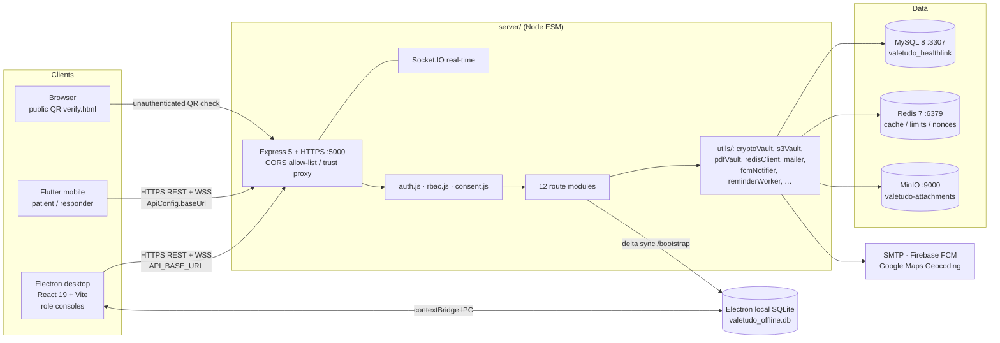

# Valetudo HealthLink

> Repository: `KaynX64/AbsoluteDogshit` · GitHub description: **"CC106 Project"** · License: **GPL-2.0**
>
> `AbsoluteDogshit` is the repository name. The application brands itself **Valetudo HealthLink** in code (`productName` and `appId com.psu.valetudo.desktop` in `desktop/package.json`, and the header of `server/schema.sql`).

A campus clinic / health-information system made of three cooperating parts:

| Part | What it is |
| --- | --- |
| `server/` | Node.js REST + WebSocket API with MySQL, Redis and MinIO/S3 storage |
| `desktop/` | Windows-first Electron staff console (React + TypeScript + Vite) with an offline SQLite queue |
| `mobile/` | Flutter patient portal and emergency-responder app with Firebase push and QR health passes |

The system is designed around **R.A. 10173 (Data Privacy Act of 2012)** : statutory consent gating, AES-256-GCM field encryption of protected health information (PHI), audit/PHI-access logging, 8-hour inactivity timeouts, and per-endpoint rate limits.

**Contents:** [Tech Stack](#1-tech-stack) · [Features](#2-features) · [Architecture](#3-architecture) · [Data Structure](#4-data-structure) · [File Structure](#5-file-structure) · [Getting Started](#6-getting-started) · [Configuration](#7-configuration) · [Security & Operational Notes](#8-security--operational-notes)

---

## 1. Tech Stack

| Layer | Technologies |
| --- | --- |
| **Backend** | Node.js ESM (`"type": "module"`), **Express 5** (`express ^5.3.0`), **Socket.IO 4** (`^4.8.3`), `mysql2 ^3.24.4` (promise pool), `ioredis ^6.0.0` + `redis ^6.2.1`, `@aws-sdk/client-s3 ^3.1141.0` (MinIO), `jsonwebtoken ^9.0.3`, `bcryptjs ^3.0.3`, `multer ^2.5.0`, `pdfkit ^0.20.2`, `exceljs ^4.4.0`, `qrcode ^1.5.4`, `nodemailer ^10.3.1`, `firebase-admin ^14.5.0`, `cors`, `dotenv`, `nodemon` (dev) |
| **Desktop** | **Electron 44** (`^44.4.1`), **React 19** + **TypeScript 5.7** + **Vite 6**, `electron-builder ^26.18.0` (NSIS/x64), `electron-updater ^6.8.9`, `socket.io-client ^4.8.1`, `jsqr ^1.4.0` (QR intake scanning), `signature_pad ^5.1.4`, built-in `node:sqlite`, `concurrently` + `wait-on` for dev orchestration, ESLint |
| **Mobile** | **Flutter** stable channel, **Dart SDK `^3.13.3`**; `http`, `flutter_secure_storage`, `qr_flutter`, `geolocator`, `socket_io_client`, `url_launcher`, `firebase_core`, `firebase_messaging`, `cupertino_icons`. Platform targets recorded in `.metadata`: Android, iOS, Linux, macOS, Web, Windows |
| **Infrastructure** | **Docker Compose**: `mysql:8.0` (`127.0.0.1:3307`), `redis:7-alpine` (`127.0.0.1:6379`), `cgr.dev/chainguard/minio:latest` (API `127.0.0.1:9000`, console `127.0.0.1:9001`), named volumes `mysql_data` and `minio_data` |
| **Tooling** | Postman collections (`server/postman/`, `server/.postman/`), Node test files (`server/tests/`), `repomix`-oriented ignore rules, GPL-2.0 `LICENSE` |

Version numbers come from `package.json` files at the repository root, `desktop/`, `mobile/pubspec.yaml` and `mobile/.metadata`; service images come from `docker-compose.yml`.

---

## 2. Features

**Identity, access control and compliance**
- Email/password login with bcrypt, JWT sessions, password-strength policy, forced/regular password change, and logout.
- Role-based access (`requireRoles`) with clinical roles `DOCTOR`, `DENTIST`, `NURSE`, `ADMIN`, `EMERGENCY_RESPONDER`, plus patient populations (students, faculty, non-teaching staff).
- Granular admin grants read live from `ADMIN_PERMISSIONS` / `USER_ADMIN_PERMISSIONS`; `SUPER_ADMIN` sentinel and legacy "no grants = full access" behavior.
- `requirePrivacyConsent` gate: clinical staff bypass it, patients need a current `CONSENT_RECORDS.is_granted = 1` or PHI access returns `403 PRIVACY_CONSENT_REQUIRED`.
- `AUDIT_LOGS` and `PHI_ACCESS_LOGS`, 8-hour inactivity timeout (both clients), and secrets validated at startup (`JWT_SECRET`, `ENCRYPTION_KEY` must be >= 32 chars).
- Rate limits: login `5/60s`, SOS `10/60s`, booking `10/60s`, public QR verification throttle — Redis-backed with in-memory fallback so the guard never fails open.

**Desktop staff consoles (`desktop/src/components/`)**
- Role-specific workspaces: `NurseConsole`, `DoctorConsole`, `AdminConsole`, `ResponderConsole`.
- `AnalyticsDashboard`, `InventoryManager`, `PrescriptionGenerator`, `QrIntakeScanner`, `DentalChart`, `VaccinationInputter`, `InteractionWarning`, `CreateUserModal`, `SignaturePad` / `SignatureEnrollment`, `EmergencyAlertBanner`, `ServerPingMonitor`, `PasswordStrengthIndicator`.
- Offline-first operation: embedded SQLite mutation queue, replay on reconnect, local EMR history and patient search, plus a `localStorage` mirror for the sidebar badge.
- Native printing, desktop notifications, and in-app auto-update via `electron-updater` (generic provider `http://localhost:8080/`).

**Mobile patient & responder app (`mobile/lib/screens/`)**
- `login_screen`, `splash_screen`, `patient_portal_screen` (role-aware identity, QR health pass), `consultation_scheduler_screen`, `documents_viewer_screen`, `edit_profile_screen`, `change_password_screen`, `responder_screen`.
- Emergency SOS with GPS location (`geolocator`), reverse geocoding (optional `GOOGLE_MAPS_API_KEY`), Firebase Cloud Messaging push, live Socket.IO events, and an `offline_sos_service` + `connectivity_service` for degraded networks.
- Secure token storage, session-timeout listener, responsive layout helper, and a debug-only self-signed-TLS override.

**Clinical and administrative workflows (12 API route modules)**
- Appointments with configurable capacity rules (`CLINIC_HOURS`: 08:00–17:00, 15-minute slots, 12:00–13:00 lunch): dentists use `exclusive-hour` capacity 1; doctors use `shared-hour` with per-type caps (General consultation 10, Prescription refill 3, Medical clearance 10, Physical examination 10) and a next-hour recovery buffer when a cap is hit.
- EMR records, vital signs, dental charts and EMR attachments; prescriptions with **FEFO inventory deduction**, outside-formulary free-text items, drug-interaction warnings, PDF generation and staff signatures.
- Medical clearances, medicine batches and inventory logs, queueing, analytics with Excel export, user administration, privacy/consent routes, and sync/bootstrap routes.
- Documents: PDFs and signatures stored in MinIO (`pdf_s3_key`, `signature_s3_key`), versioning and soft deletes (`version`, `deleted_at`), and a public `server/public/verify.html` QR verification page.
- **Dynamic QR Health Pass**: HMAC-signed with a dedicated `HEALTH_PASS_HMAC_SECRET` (or a domain-separated key derived from `JWT_SECRET`), valid 15 minutes, with single-use nonce claiming in Redis (`qr:nonce:*`, `SET NX EX`) to stop replay.
- Background reminder worker: every 15 minutes, finds `scheduled` appointments in the next 24 hours with `reminder_sent = FALSE` and sends SMTP email, FCM push and Socket.IO reminders.

---

## 3. Architecture



### Backend (`server/`)
`src/index.js` is the entry point: it loads `dotenv`, creates the Express app and an HTTPS/Socket.IO server, mounts the 12 routers (`privacy`, `profile`, `healthPass`, `appointments`, `emergency`, `inventory`, `documents`, `admin`, `analytics`, `sync`, `interactions`, `signature`), and imports the startup utilities `runAutoMigrations()` (`src/db.js`), `initRedis()` (`src/utils/redisClient.js`), `ensureBucketExists()` (`src/utils/s3Vault.js`) and `startReminderScheduler(io)` (`src/utils/reminderWorker.js`). `TRUST_PROXY` controls `X-Forwarded-For` handling behind a reverse proxy; `CORS_ALLOWED_ORIGINS` is an explicit allow-list.

`src/db.js` exposes a `mysql2/promise` pool (`connectionLimit: 10`, `charset: utf8mb4_unicode_ci`) and a lightweight boot-time migration that adds newer columns/ENUM values. Redis is cache-aside with a 120-second default TTL and **degrades to direct MySQL queries** when unavailable. MinIO is configured with `forcePathStyle: true`; the bucket is created on startup if missing.

Security layering per request: `authenticateToken` -> `requireRoles(...)` -> optional granular admin permission resolution -> `requirePrivacyConsent` -> route handler -> `logAudit` / `logPhiAccess`. PHI is encrypted/decrypted through `cryptoVault.js` at the field level.

### Desktop (`desktop/`)
- `electron/main.cjs` — main process: `BrowserWindow`, HTTPS/WSS URLs, IPC handlers, native `node:sqlite` database at `userData/valetudo_data/valetudo_offline.db`, printing/notifications, and `electron-updater`.
- `electron/preload.cjs` — `contextBridge.exposeInMainWorld('electronAPI', …)` exposing 12 methods: `printDocument`, `showNotification`, 7 offline-queue methods, `onUpdateStatus`, `installUpdate`, `getAppVersion`.
- `src/` — React renderer: `App.tsx` switches between role consoles, `config/api.ts` derives `API_BASE_URL` and `SOCKET_URL` from `app-config.json`, `services/offlineSync.ts` prefers Electron IPC/SQLite and falls back to `localStorage`, `hooks/` provides booking-badge and server-ping state.
- `npm run dist` builds a Windows NSIS x64 installer named `ValetudoHealthLink-Setup-${version}.exe` into `desktop/release`.

### Mobile (`mobile/`)
`lib/main.dart` initializes Flutter bindings, Firebase (native platforms only, with an FCM background handler), `EmergencyAlertService`, `ConnectivityService`, then `ValetudoMobileApp`. `lib/config/api_config.dart` defines the HTTP/Socket base URL (currently a hardcoded LAN address for Android). Screens, services, widgets and utils are split by responsibility; `session_timeout_listener.dart` enforces the same inactivity policy as the desktop client.

### Data flows
- **Offline write:** renderer queues an `OfflineMutation` -> IPC -> SQLite `LOCAL_SYNC_LOGS` -> replay to `/api/sync/*` when connectivity returns; `GET /api/sync/bootstrap?lastSyncedAt=…` pre-populates the workstation cache with a delta of the active roster.
- **SOS:** mobile collects coordinates -> emergency router -> `EMERGENCY_ALERTS` -> FCM push to responder roles + Socket.IO broadcast + desktop `EmergencyAlertBanner`.
- **Document verification:** PDF/clearance stored in MinIO -> QR points at `PUBLIC_API_BASE_URL` -> `verify.html` -> nonce claimed atomically in Redis -> single successful verification.

---

## 4. Data Structure

### Relational schema — `server/schema.sql`
A single `valetudo_healthlink` MySQL database (`utf8mb4` / `utf8mb4_unicode_ci`) with **29 tables**. The file is a **full drop-and-recreate script** (`DROP TABLE IF EXISTS …` then `CREATE TABLE …`) — run it only against a fresh database. Ongoing drift is handled separately by `runAutoMigrations()`.

| Domain | Tables |
| --- | --- |
| Identity & access | `USERS`, `ROLES`, `USER_ROLES`, `ADMIN_PERMISSIONS`, `USER_ADMIN_PERMISSIONS` |
| Population profiles | `STUDENT_PROFILES`, `FACULTY_PROFILES`, `NON_TEACHING_PROFILES`, `STAFF_PROFILES` |
| Health, consent, devices | `HEALTH_PROFILES`, `CONSENT_RECORDS`, `DEVICE_TOKENS` |
| Scheduling | `APPOINTMENTS`, `QUEUE` |
| EMR | `EMR_RECORDS`, `VITAL_SIGNS`, `DENTAL_CHARTS`, `EMR_ATTACHMENTS` |
| Pharmacy & inventory | `MEDICINES`, `MEDICINE_BATCHES`, `INVENTORY_LOGS`, `DRUG_INTERACTIONS`, `PRESCRIPTIONS`, `PRESCRIPTION_ITEMS` |
| Clearances | `MEDICAL_CLEARANCES` |
| Emergency | `EMERGENCY_ALERTS` |
| Audit & sync | `AUDIT_LOGS`, `PHI_ACCESS_LOGS`, `LOCAL_SYNC_LOGS` |

Representative columns visible in the schema and queries: `USERS(user_id BIGINT AUTO_INCREMENT PK, email VARCHAR(255) UNIQUE, first_name, last_name, phone, is_active, deleted_at)`; `HEALTH_PROFILES(profile_id, user_id, blood_type, allergies, chronic_conditions)`; `APPOINTMENTS(appointment_id, patient_user_id, doctor_user_id, date_time, appointment_type, status, reminder_sent)`; `CONSENT_RECORDS(consent_id, user_id, is_granted)`; `ADMIN_PERMISSIONS(permission_id, code)` and `USER_ADMIN_PERMISSIONS(user_id, permission_id)`. Boot migrations add `PRESCRIPTIONS.signature_metadata JSON`, `pdf_s3_key VARCHAR(500)`, `version INT DEFAULT 1`, `deleted_at TIMESTAMP NULL`; `PRESCRIPTION_ITEMS.outside_name`; `MEDICAL_CLEARANCES.pdf_s3_key/version/deleted_at`; and `STAFF_PROFILES.signature_s3_key`.

### Encrypted PHI
`utils/cryptoVault.js` uses **AES-256-GCM** with a 12-byte IV and 16-byte auth tag. Key = `scrypt(ENCRYPTION_KEY, ENCRYPTION_SALT)`; stored values use the envelope `enc:v2:<iv_hex>:<tag_hex>:<ciphertext_hex>`. Legacy `enc:v1` values are rejected with `[ENCRYPTED PHI - INTEGRITY VERIFICATION FAILED]`. `scripts/encrypt-plaintext-health-profiles.js` migrates `HEALTH_PROFILES.allergies` and `chronic_conditions` in 200-row batches, dry-run by default (`--apply` to write), verifying each ciphertext by decrypting it before the guarded `UPDATE`.

### Object storage, cache and queue keys
- **MinIO/S3:** bucket `valetudo-attachments` (`S3_BUCKET`); object keys are stored in DB columns such as `pdf_s3_key` and `signature_s3_key`.
- **Redis:** cache-aside JSON with 120-second default TTL; `ratelimit:login:<ip>`, `ratelimit:sos:<user|ip>`, `qr:nonce:<nonce>` (15-minute, `SET NX EX`); helper functions `getCache`, `setCache`, `invalidateCache`, `isRedisActive`.
- **Electron SQLite:** `valetudo_offline.db` with `LOCAL_SYNC_LOGS(sync_id, client_mutation_id UNIQUE, user_id, device_id, table_name, record_id, record_uuid, action, payload, local_version, sync_status, error_message, created_at, synced_at)` plus additional cache tables.
- **Renderer types:** `OfflineMutation { client_mutation_id, table_name, record_uuid, action: CREATE|UPDATE|DELETE, payload, created_at, user_id?, device_id?, local_version? }`; `localStorage` keys `valetudo_offline_mutations_queue`, `valetudo_last_sync_time`, `valetudo_token` / `token`.

---

## 5. File Structure

Abridged tree of the `main` branch (generated folders and third-party dependencies omitted):

```
AbsoluteDogshit/
├── .gitignore                 # node_modules, .env*, build outputs, certs, Firebase creds
├── .gitignore.backup
├── LICENSE                    # GPL-2.0
├── docker-compose.yml         # mysql + redis + minio, loopback-bound
├── package.json               # root devDependencies only (concurrently, electron, wait-on); no scripts
├── package-lock.json
│
├── desktop/                   # valetudo-desktop v1.0.1
│   ├── app-config.json        # { "apiBaseUrl": "https://localhost:5000" }
│   ├── electron/
│   │   ├── main.cjs           # main process, node:sqlite, IPC, auto-update
│   │   └── preload.cjs        # contextBridge electronAPI (12 methods)
│   ├── public/                # favicon.svg, icons.svg
│   ├── src/
│   │   ├── App.tsx / App.css / main.tsx / index.css / electron.d.ts / theme.*
│   │   ├── assets/            # hero.png, valetudo_logo.png, react.svg, vite.svg
│   │   ├── components/        # AdminConsole, DoctorConsole, NurseConsole,
│   │   │                      # ResponderConsole, AnalyticsDashboard, QrIntakeScanner,
│   │   │                      # InventoryManager, PrescriptionGenerator, DentalChart, …
│   │   ├── config/api.ts      # API_BASE_URL + SOCKET_URL
│   │   ├── hooks/             # useBookingBadge.ts, useServerPing.ts
│   │   └── services/          # offlineSync.ts, interactionService.ts
│   ├── eslint.config.js
│   ├── index.html
│   ├── package.json / package-lock.json
│   └── README.md              # Vite + React + TS template stub
│
├── mobile/                    # Flutter app, Dart ^3.13.3
│   ├── lib/
│   │   ├── main.dart          # Firebase/FCM bootstrap, theme, services
│   │   ├── config/            # api_config.dart
│   │   ├── screens/           # splash, login, patient_portal, responder,
│   │   │                      # consultation_scheduler, documents_viewer,
│   │   │                      # edit_profile, change_password
│   │   ├── services/          # connectivity, emergency_alert, offline_sos
│   │   ├── utils/             # responsive.dart
│   │   └── widgets/           # session_timeout_listener, valetudo_logo
│   ├── android/ ios/ linux/   # platform runners (macos/web/windows targets in .metadata)
│   ├── assets/
│   ├── .metadata / analysis_options.yaml / pubspec.yaml
│   └── README.md              # Flutter template stub
│
└── server/                    # valetudo-backend v1.0.0
    ├── .env.example           # all configuration, with comments and audit IDs
    ├── schema.sql             # full 29-table MySQL schema (destructive recreate)
    ├── package.json / package-lock.json
    ├── src/
    │   ├── index.js           # HTTPS + Express + Socket.IO entry point
    │   ├── auth.js            # login, JWT, bcrypt, password policy, rate limit
    │   ├── db.js              # mysql2 pool + runAutoMigrations()
    │   ├── config/            # appointmentRules.js, limits.js
    │   ├── middleware/        # rbac.js, consent.js
    │   ├── routes/            # admin, analytics, appointments, documents,
    │   │                      # emergency, healthPass, interactions, inventory,
    │   │                      # privacy, profile, signature, sync  (12 modules)
    │   └── utils/             # 18 modules: cryptoVault, s3Vault, pdfVault,
    │                          # signatureVault, redisClient, mailer, fcmNotifier,
    │                          # reminderWorker, auditLogger, phiLogger, signatory, …
    ├── scripts/               # encrypt-plaintext-health-profiles.js
    ├── public/verify.html     # public QR document verification page
    ├── postman/ .postman/     # API collections / globals
    ├── tests/                 # analyticsStats, cryptoVault, dbStudioGuard, reencrypt
    ├── valetudo_healthlink/   # auxiliary project directory
    └── node_modules/          # currently tracked in git despite .gitignore
```

---

## 6. Getting Started

### Prerequisites
- Node.js **22+** (the desktop app uses built-in `node:sqlite`, which requires Node 22+ / Electron 32+), npm
- Docker + Docker Compose
- Flutter SDK on the stable channel with Dart `^3.13.3`
- Optional: MySQL client, Postman, Firebase project credentials

### 1. Start infrastructure
```bash
git clone https://github.com/KaynX64/AbsoluteDogshit.git
cd AbsoluteDogshit
docker compose up -d
```
This starts MySQL on `127.0.0.1:3307`, Redis on `127.0.0.1:6379` and MinIO on `127.0.0.1:9000` (console `:9001`). All three are bound to loopback only — see the `SEC-12` comments in `docker-compose.yml`.

### 2. Configure and run the API
```bash
cd server
npm install
cp .env.example .env
# edit .env — see the Configuration section below
npm run dev        # nodemon src/index.js
# or: npm start    # node src/index.js
```
- The API listens on `PORT` (default `5000`) over HTTPS; both clients default to `https://…:5000`. Keep TLS material in `server/certs/` (git-ignored: `*.pem`, `*.key`, `*.crt`).
- Make `DB_USER` / `DB_PASSWORD` match the Compose MySQL instance. Compose sets `MYSQL_ROOT_PASSWORD=rootpassword`, and `.env.example` defaults to `DB_USER=valetudo_app`, `DB_PORT=3307`, `DB_NAME=valetudo_healthlink`. Create that user, or point `DB_USER` at `root`.
- Apply `schema.sql` **only to a fresh database** — it drops all 29 tables. `runAutoMigrations()` adds newer columns on boot.
- `npm install` in `server/` is also needed because `server/node_modules/` is currently committed; see the notes below.

### 3. Run the desktop console
```bash
cd desktop
npm install
npm run dev      # concurrently: Vite on 127.0.0.1:5173, then Electron
npm run build    # tsc && vite build
npm run dist     # Windows NSIS x64 installer -> desktop/release/
```
`desktop/app-config.json` (`apiBaseUrl`) and the Vite URL in `electron/main.cjs` (`https://127.0.0.1:5173`) are development defaults; change them for a LAN deployment. `desktop/src/config/api.ts` derives both REST and Socket URLs from that file.

### 4. Run the mobile app
```bash
cd mobile
flutter pub get
flutter run
```
Update `mobile/lib/config/api_config.dart` — it currently hardcodes `https://192.168.18.116:5000` for Android (with a commented emulator alternative `https://10.0.2.2:5000`). Firebase needs `mobile/android/app/google-services.json` and `server/serviceAccountKey.json`, both git-ignored; without them the app still runs but push notifications are disabled. The self-signed-certificate override in `main.dart` is active **only in debug builds**.

### 5. Tests
Four Node test files live in `server/tests/` (`analyticsStats.test.js`, `cryptoVault.test.js`, `dbStudioGuard.test.js`, `reencrypt.test.js`). `server/package.json` defines only `dev` and `start` — there is no `npm test` script yet, so run them with your Node test runner explicitly, e.g. `node --test tests/`.

---

## 7. Configuration

`server/.env.example` is the authoritative list. Key groups:

| Group | Variables | Notes |
| --- | --- | --- |
| Server | `PORT=5000`, `PUBLIC_API_BASE_URL`, `CORS_ALLOWED_ORIGINS`, `TRUST_PROXY=false` | Public URL is embedded in generated PDFs and QR codes; CORS is a comma-separated allow-list (include `null` for packaged `file://` Electron builds) |
| Secrets | `JWT_SECRET`, `ENCRYPTION_KEY`, `ENCRYPTION_SALT`, `HEALTH_PASS_HMAC_SECRET` | Generate with `openssl rand -hex 32` (salt: `openssl rand -hex 16`). **Back up `ENCRYPTION_KEY` and `ENCRYPTION_SALT` together** — losing either makes PHI unrecoverable. The QR key must differ from `JWT_SECRET` |
| MySQL | `DB_HOST`, `DB_PORT=3307`, `DB_USER`, `DB_PASSWORD`, `DB_NAME=valetudo_healthlink`, `MYSQL_ROOT_PASSWORD` | `db.js` refuses to start if the password is missing |
| Redis | `REDIS_HOST`, `REDIS_PORT=6379`, `REDIS_PASSWORD` | Compose sets `valetudo_redis_secret_password_2026` |
| MinIO / S3 | `S3_ENDPOINT=http://127.0.0.1:9000`, `S3_ACCESS_KEY`, `S3_SECRET_KEY`, `S3_BUCKET=valetudo-attachments`, `MINIO_ROOT_USER`, `MINIO_ROOT_PASSWORD` | Compose defaults: `minioadmin` / `minioadminpassword` |
| Mail & push | `SMTP_HOST`, `SMTP_PORT=587`, `SMTP_USER`, `SMTP_PASS`, Firebase service account, optional `GOOGLE_MAPS_API_KEY` | Used by `mailer.js`, `fcmNotifier.js`, SOS reverse geocoding |
| Throttles | `LOGIN_RATE_LIMIT_MAX/WINDOW`, `SOS_RATE_LIMIT_MAX/WINDOW`, `BOOKING_RATE_LIMIT_MAX/WINDOW`, `VERIFY_RATE_LIMIT_*` | Defaults in `src/config/limits.js`: `5/60`, `10/60`, `10/60` |

`.env` and all `.env.*` files except `.env.example` are ignored by git, as are build outputs (`dist/`, `build/`, `desktop/release`), IDE folders, private certificates and Firebase credentials.

---

## 8. Security & Operational Notes

- **Development credentials are committed.** `docker-compose.yml` contains example passwords and `PUBLIC_API_BASE_URL` / `api_config.dart` contain a LAN IP. Replace all of them before any real deployment; keeping the Compose ports bound to `127.0.0.1` is deliberate (`SEC-12`).
- **`server/node_modules/` is tracked in git** even though `.gitignore` ignores `node_modules/`. Consider `git rm -r --cached server/node_modules` and re-committing.
- **`schema.sql` is destructive.** It begins with `DROP TABLE IF EXISTS` for all 29 tables; it is not a migration.
- **Key separation matters.** `HEALTH_PASS_HMAC_SECRET` exists specifically so a leaked QR signing key cannot forge session tokens (audit `SEC-08`); if unset, a domain-separated key is derived from `JWT_SECRET`.
- **Consent is a hard gate.** Removing or bypassing `requirePrivacyConsent` breaks the R.A. 10173 compliance model the schema and audit logs are built around.
- **Template stubs remain.** `desktop/README.md` is the Vite + React + TS template and `mobile/README.md` is the default Flutter starter; this root README is the real documentation.
- **The root `package.json` has no scripts** — only `concurrently`, `electron` and `wait-on` as devDependencies. Build and run commands are per-subproject (`server/`, `desktop/`, `mobile/`).
- Code comments reference internal audit IDs (`SEC-05`, `SEC-08`, `SEC-09`, `SEC-10`, `SEC-12`, `S-04`–`S-29`, `B-02`); they are useful when tracing a security decision back to its remediation.

### License
GNU General Public License **v2.0** — see [`LICENSE`](LICENSE).
