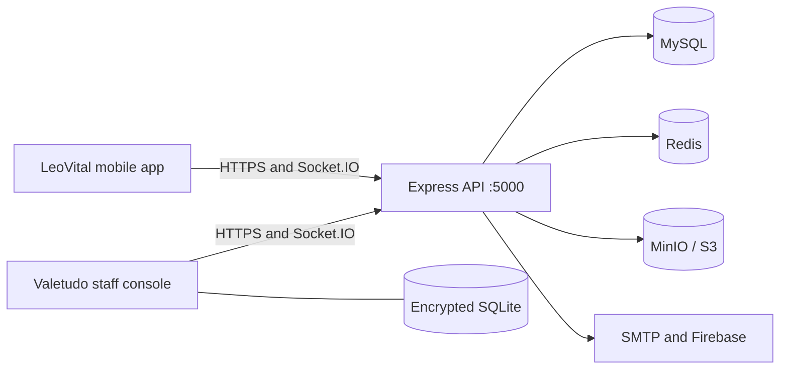

<div align="center">


# 🩺 Valetudo HealthLink

**Campus clinic management for Pangasinan State University**

[](desktop/README.md)
[](mobile/README.md)
[](BACKEND-STUDY-GUIDE.md)
[](LICENSE)

[✨ Features](#-key-features) · [🏗️ Architecture](#-architecture) · [🚀 Getting started](#-getting-started) · [📡 API](#-api-endpoints) · [🧪 Testing](#-testing)

</div>

---

## 📖 Overview

**Valetudo HealthLink** connects students and employees with clinic staff and emergency responders. Patients and responders use the **LeoVital HealthLink** Flutter app. Staff use the Electron console for care and administration.

## ✨ Key features

| Area | Workflow |
| --- | --- |
| 📅 **Patient portal** | Book a consultation, track a queue ticket, show a QR health pass, and retrieve issued documents. |
| 🩺 **Clinical care** | Check in appointments and walk-ins, record triage measurements, review medical history, and document consultations and dental care. |
| 💊 **Prescriptions and inventory** | Issue prescriptions and clearances, verify documents by QR, and track clinic stock by batch. Clinic dispensing draws from eligible stock by earliest expiry. |
| 🚨 **Emergency response** | Send a location-based SOS, notify eligible responders, track the incident, and file official reports in the desktop console. |
| 🔄 **Offline support** | Desktop caches supported clinic data in encrypted SQLite and replays queued changes on reconnect. Mobile queues eligible SOS requests for retry. |
| 📊 **Administration** | Manage accounts, roles and grants, review audit logs and scoped analytics, and inspect server health. |

## 🏗️ Architecture



The API applies clinical rules and access checks. It stores records in MySQL and files in MinIO or S3. Redis supports caching and session controls. [Backend study guide](BACKEND-STUDY-GUIDE.md)

## 📂 Repository Structure

All Git-tracked folders and subfolders are shown below, along with selected files.

```text
Valetudo/                                       # Project repository
├── AGENTS-parts/                               # Project development guidance
├── desktop/                                    # Electron clinic staff console
│   ├── AGENTS-parts/                           # Staff console development guidance
│   ├── docs/                                   # Console layout, workflows, and source maps
│   │   └── codeslice/                          # Line-range maps for desktop source files
│   ├── electron/                               # Main process, preload, and offline storage
│   │   └── offline/                            # Encrypted SQLite, mutation queue, and IPC
│   ├── public/                                 # Static desktop assets
│   │   └── licenses/                           # Bundled font and icon licenses
│   ├── src/                                    # React and TypeScript renderer
│   │   ├── app/                                # Sign-in, navigation, and session shell
│   │   ├── assets/                             # Project logo and Windows app icon
│   │   ├── config/                             # Renderer API configuration
│   │   ├── features/                           # Clinic and admin workspaces
│   │   │   ├── admin/                          # Account, audit, and system administration
│   │   │   ├── analytics/                      # Reports, charts, and analytics dashboard
│   │   │   │   └── tabs/                       # Overview, campus, clinical, and pharmacy views
│   │   │   ├── appointments/                   # QR scanning and triage entry
│   │   │   ├── consultations/                  # Clinician workspace, encounter editor, and history
│   │   │   ├── documents/                      # Prescribing, signatures, and document review
│   │   │   ├── emergency/                      # SOS console and incident reports
│   │   │   ├── inventory/                      # Stock, inventory logs, and alerts
│   │   │   └── nurse/                          # Nurse station and expected arrivals
│   │   ├── img_icons/                          # Bundled fonts and Material Symbols
│   │   ├── pages/                              # Placeholder directory for pages
│   │   ├── platform/                           # Realtime and offline sync
│   │   │   ├── connectivity/                   # Server reachability checks
│   │   │   ├── offline/                        # Cache bootstrap, queued writes, and replay
│   │   │   └── realtime/                       # Socket.IO client and window identity
│   │   ├── shared/                             # Components and styles shared by workspaces
│   │   │   └── ui/                             # Dialogs, icons, and other UI primitives
│   │   └── theme/                              # Appearance presets, tokens, and theme provider
│   ├── tests/                                  # Desktop unit and integration tests
│   │   └── smoke/                              # Packaged app and workflow smoke checks
│   └── app-config.json                         # API origin for the desktop build
├── mobile/                                     # Flutter patient and responder app
│   ├── android/                                # Android platform project and Gradle setup
│   │   ├── app/                                # Android application module and build settings
│   │   │   └── src/                            # Android source sets and resources
│   │   │       ├── debug/                      # Debug Android manifest
│   │   │       ├── main/                       # Shared Android manifest, code, and resources
│   │   │       │   ├── kotlin/                 # Kotlin source root
│   │   │       │   │   └── com/                # Start of the reverse-domain package path
│   │   │       │   │       └── psu/            # PSU namespace
│   │   │       │   │           └── valetudo/   # Valetudo namespace
│   │   │       │   │               └── mobile/  # Android MainActivity
│   │   │       │   └── res/                    # Android launcher, splash, sound, and theme resources
│   │   │       │       ├── drawable/           # Default splash and launch drawables
│   │   │       │       ├── drawable-nodpi/     # Splash logo without density scaling
│   │   │       │       ├── drawable-v21/       # Launch background for Android API 21+
│   │   │       │       ├── mipmap-anydpi-v26/  # Adaptive launcher icons for Android API 26+
│   │   │       │       ├── mipmap-hdpi/        # High-density launcher icons
│   │   │       │       ├── mipmap-mdpi/        # Medium-density launcher icons
│   │   │       │       ├── mipmap-xhdpi/       # Extra-high-density launcher icons
│   │   │       │       ├── mipmap-xxhdpi/      # Double-extra-high-density launcher icons
│   │   │       │       ├── mipmap-xxxhdpi/     # Triple-extra-high-density launcher icon
│   │   │       │       ├── raw/                # Android emergency alert sound
│   │   │       │       ├── values/             # Default colors and styles
│   │   │       │       └── values-night/       # Dark-mode launch styles
│   │   │       └── profile/                    # Profile-mode Android manifest
│   │   └── gradle/                             # Gradle wrapper configuration
│   │       └── wrapper/                        # Pinned Gradle distribution settings
│   ├── assets/                                 # Flutter logo and emergency alert audio
│   ├── ios/                                    # iOS platform project
│   │   ├── Flutter/                            # Flutter iOS build configuration
│   │   ├── Runner/                             # iOS app host and resources
│   │   │   ├── Assets.xcassets/                # iOS app icons and launch images
│   │   │   │   ├── AppIcon.appiconset/         # iOS app icon sizes
│   │   │   │   └── LaunchImage.imageset/       # iOS launch image sizes
│   │   │   └── Base.lproj/                     # iOS main and launch storyboards
│   │   ├── Runner.xcodeproj/                   # Xcode project for the iOS host
│   │   │   ├── project.xcworkspace/            # Workspace embedded in the iOS project
│   │   │   │   └── xcshareddata/               # Shared settings for the embedded workspace
│   │   │   └── xcshareddata/                   # Shared iOS project configuration
│   │   │       └── xcschemes/                  # Shared iOS build and run scheme
│   │   ├── Runner.xcworkspace/                 # Workspace for the iOS app
│   │   │   └── xcshareddata/                   # Shared settings for the app workspace
│   │   └── RunnerTests/                        # Native iOS runner tests
│   ├── lib/                                    # Dart application code
│   │   ├── config/                             # REST and realtime API origin
│   │   ├── models/                             # Prescription and responder record models
│   │   ├── screens/                            # Patient portal and responder views
│   │   │   ├── AGENTS-parts/                   # Mobile screen development guidance
│   │   │   └── codeslice/                      # Line-range maps for mobile source files
│   │   │       └── MB-01-PatientPortalScreen-parts/  # Split patient portal source map
│   │   ├── services/                           # Session, connectivity, and SOS delivery
│   │   ├── theme/                              # Account appearance and color palettes
│   │   ├── utils/                              # Responsive layout helpers
│   │   └── widgets/                            # Shared controls and Responder Hub
│   ├── linux/                                  # Linux platform project
│   │   ├── flutter/                            # Flutter Linux build and plugin wiring
│   │   └── runner/                             # Native Linux application host
│   ├── macos/                                  # macOS platform project
│   │   ├── Flutter/                            # Flutter macOS build and plugin wiring
│   │   ├── Runner/                             # Native macOS app host and resources
│   │   │   ├── Assets.xcassets/                # macOS app image catalog
│   │   │   │   └── AppIcon.appiconset/         # macOS app icon sizes
│   │   │   ├── Base.lproj/                     # Default macOS main menu
│   │   │   └── Configs/                        # macOS app metadata and build settings
│   │   ├── Runner.xcodeproj/                   # Xcode project for the macOS host
│   │   │   ├── project.xcworkspace/            # Workspace embedded in the macOS project
│   │   │   │   └── xcshareddata/               # Shared checks for the embedded workspace
│   │   │   └── xcshareddata/                   # Shared macOS project configuration
│   │   │       └── xcschemes/                  # Shared macOS build and run scheme
│   │   ├── Runner.xcworkspace/                 # Workspace for the macOS app
│   │   │   └── xcshareddata/                   # Shared checks for the app workspace
│   │   └── RunnerTests/                        # Native macOS runner tests
│   ├── test/                                   # Flutter tests
│   ├── web/                                    # Flutter web entry page and manifest
│   │   └── icons/                              # Web app icons and maskable variants
│   └── windows/                                # Windows platform project
│       ├── flutter/                            # Flutter Windows build and plugin wiring
│       └── runner/                             # Native Windows application host
│           └── resources/                      # Windows executable icon
├── README-parts/                               # Historical Stage1 documentation
├── scripts/                                    # Repository verification utilities
├── server/                                     # Express API and Socket.IO server
│   ├── .postman/                               # Postman workspace resource registration
│   ├── AGENTS-parts/                           # Backend development and operations guidance
│   ├── postman/                                # Postman workspace files
│   │   └── globals/                            # Workspace-level Postman globals
│   ├── public/                                 # Public QR document verification page
│   ├── scripts/                                # Migration, maintenance, and PDF fixture scripts
│   ├── server/                                 # Legacy nested server directory
│   │   └── certs/                              # Legacy certificate path outside runtime configuration
│   ├── src/                                    # Backend entry points, routes, and domain code
│   │   ├── admin/                              # Account and access administration
│   │   │   └── accounts/                       # Account, role, grant, and profile changes
│   │   ├── analytics/                          # Scoped analytics queries and summaries
│   │   │   └── reports/                        # CSV, Excel, and PDF export rendering
│   │   ├── appointments/                       # Queue rules, encounter validation, and history
│   │   ├── auth/                               # Sign-in, session checks, and download tokens
│   │   ├── bootstrap/                          # Startup, shutdown, supervision, and diagnostics
│   │   ├── config/                             # Booking, rate-limit, and server policy
│   │   ├── db/                                 # MySQL pool and migrations
│   │   │   └── migrations/                     # Versioned MySQL schema updates
│   │   ├── documents/                          # Clinical document workflows and PDF recovery
│   │   │   ├── generation/                     # Document generation and object-storage writes
│   │   │   ├── pdf/                            # Shared PDF rendering helpers
│   │   │   │   └── templates/                  # Prescription, clearance, and incident layouts
│   │   │   ├── prescriptions/                  # Prescription review, issuance, expiry, and cancellation
│   │   │   └── signing/                        # Clinician eligibility and signature storage
│   │   ├── emergency/                          # SOS dispatch, responder access, and incident filing
│   │   ├── inventory/                          # Formulary, stock movements, and pharmacy analytics
│   │   ├── middleware/                         # Role, permission, and consent checks
│   │   ├── realtime/                           # Socket.IO access, rooms, and connected sessions
│   │   ├── routes/                             # Feature endpoints
│   │   │   ├── admin/                          # Account, audit, policy, and diagnostics endpoints
│   │   │   │   ├── databaseStudio/             # Database Studio reads, writes, and table access
│   │   │   │   └── userUpdates/                # Account profile and role update endpoints
│   │   │   ├── AGENTS-parts/                   # API routing and handler guidance
│   │   │   ├── analytics/                      # Dashboard and report export endpoints
│   │   │   ├── appointments/                   # Booking, queue, intake, and encounter endpoints
│   │   │   │   ├── booking/                    # Availability, appointment creation, and cancellation
│   │   │   │   └── intake/                     # Booked check-in, walk-ins, and patient lookup
│   │   │   ├── documents/                      # Clinical files, signing workflows, and PDF routes
│   │   │   │   ├── prescriptions/              # Prescription issuance, history, and cancellation routes
│   │   │   │   └── verification/               # Public and protected document verification routes
│   │   │   ├── emergency/                      # SOS, active alerts, and responder history endpoints
│   │   │   │   └── incidentReports/            # Pending, filed, and archived incident report routes
│   │   │   ├── inventory/                      # Formulary, receiving, and stock endpoints
│   │   │   ├── profile/                        # Patient profile, health data, and preferences endpoints
│   │   │   └── sync/                           # Workstation cache bootstrap and replay endpoints
│   │   ├── sync/                               # Offline checkpoint, replay, and conflict handling
│   │   ├── utils/                              # Encryption, auditing, and shared service clients
│   │   ├── workers/                            # Scheduled jobs
│   │   └── app.js                              # Express middleware and route mounts
│   ├── tests/                                  # API and domain tests
│   │   └── fixtures/                           # Shared prescribing test data
│   └── schema.sql                              # Fresh MySQL schema
├── docker-compose.yml                          # Local MySQL, Redis, and MinIO
└── DOCUMENTATION.md                            # Project guides and references
```

## 🚀 Getting started

Install **Node.js 22+** with npm, Docker Compose, OpenSSL, and a MySQL client. For mobile, use Android tools and a Flutter SDK compatible with [`mobile/pubspec.yaml`](mobile/pubspec.yaml).

### ⚙️ 1. Start the infrastructure and API

From the repository root, start the local services and create the server's environment file if it does not already exist.

```powershell
docker compose up -d
if (-not (Test-Path server/.env)) { Copy-Item server/.env.example server/.env }
```

Configure `server/.env` and generate the TLS certificate. Use `server/schema.sql` for an empty database and `npm run migrate` from `server/` for an existing one. [Server bootstrap](AGENTS-parts/AGENTS-01.md#bootstrap-a-dev-machine-order-matters) · [Migrations](server/MIGRATION-PLAN.md)

```powershell
Set-Location server
npm install
npm run dev
```

The API defaults to `https://localhost:5000`. `GET /api/ping` should return `ok: true`. [Postman and certificate setup](POSTMAN-API-GUIDE.md)

### 🖥️ 2. Run the desktop console

From the repository root, check `apiBaseUrl` in [`desktop/app-config.json`](desktop/app-config.json) and run the console.

```powershell
Set-Location desktop
npm install
npm run dev
```

Use `npm run dist` from `desktop/` to build the Windows installer with the configured API URL. [Desktop packaging](desktop/README.md)

### 📱 3. Run the mobile app

For Android, add your test Firebase project's `google-services.json` to `mobile/android/app/` before building. From the repository root, run Flutter against the Android emulator. For a physical phone, use the API host's LAN address and a certificate covering that address. [Firebase setup](mobile/AGENTS.md#firebase)

```powershell
Set-Location mobile
flutter pub get
flutter run --dart-define=API_BASE_URL=https://10.0.2.2:5000
```

[Mobile release builds and device setup](mobile/README.md)

## 📡 API endpoints

The REST API is mounted under `/api`. Protected endpoints use a Bearer JWT and enforce the applicable consent, role, grant, and record-access rules.

| Method | Endpoint | Use |
| --- | --- | --- |
| GET | `/api/ping` | Check whether the listener is reachable. |
| POST | `/api/auth/login` | Sign in and receive a session token. |
| GET | `/api/appointments/slots` | Read a practitioner's availability for a clinic date. |
| POST | `/api/appointments` | Book a consultation. |
| POST | `/api/appointments/:id/checkin` | Check in a booked patient. |
| GET | `/api/documents/verify/:qrToken` | Check the status of a document using its public QR token. |
| POST | `/api/emergency/sos/requests` | Submit a location-based SOS with a retry identifier. |
| GET | `/api/analytics/summary` | Read analytics within the caller's scopes. |

[Postman requests and expected responses](POSTMAN-API-GUIDE.md) · [Server route map](server/src/routes/AGENTS.md)

## 🧪 Testing

Run each command from its module directory.

| Module | Command |
| --- | --- |
| Server | `node --test` |
| Desktop | `npm test` |
| Mobile | `flutter test` |

Use synthetic data for manual checks. [MySQL-backed tests](BACKEND-STUDY-GUIDE.md#7-study-exercises) · [Packaged desktop checks](desktop/README.md#verification)

## 🔒 Privacy and security

The API uses HTTPS by default and enforces session, role, and consent checks. Selected clinical fields and the desktop offline database are encrypted. Keep secrets and patient data out of version control. [Project security guidance](AGENTS-parts/AGENTS-02.md#security-invariants)

## 📄 License

Valetudo HealthLink is licensed under the [GNU General Public License v2.0](LICENSE).

[Documentation index](DOCUMENTATION.md) · [Codebase overview](CODEBASE-OVERVIEW.md) · [Historical Stage1 README](README-parts/README-01.md)
