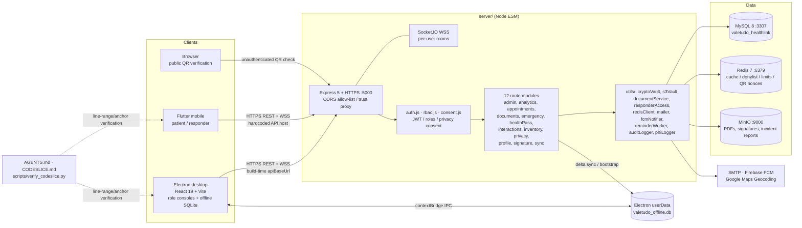

# Valetudo HealthLink

> Repository: `KaynX64/AbsoluteDogshit` · GitHub description: **CC106 Project** · License: **GPL-2.0**
>
> `AbsoluteDogshit` is the repository name; the system is branded **Valetudo HealthLink** in `desktop/package.json` and `server/schema.sql`.
>
> **Documentation snapshot:** `Stage1` branch at `c8651d1ea88a438a5cc078c6613c11e35515e5c5` (2026-11-07 16:13:32 UTC). This README supersedes the 3,170-byte `AGENTS.md Pack` note currently stored as `Stage1/README.md`.

A **Palawan State University campus clinic management system**: appointments and queueing, EMR, e-prescriptions, dental charts, medicine inventory, emergency SOS, incident reporting, health passes and QR document verification. Philippine **R.A. 10173 (Data Privacy Act of 2012)** is a design constraint — treat any row containing patient data as PHI.

It is a monorepo with **three deployables** and **no npm workspaces, no root scripts and no submodules**. Each module installs and runs from its own folder; the root `package.json` only pins shared tooling (`concurrently`, `wait-on`, `electron`). `server/` owns all business logic and is the sole database owner.

**Contents:** [Stage1 changes](#what-changed-on-stage1) · [1. Tech Stack](#1-tech-stack) · [2. Features](#2-features) · [3. Architecture](#3-architecture) · [4. Data Structure](#4-data-structure) · [5. File Structure](#5-file-structure) · [6. Getting Started](#6-getting-started) · [7. Configuration](#7-configuration) · [8. Tests & Documentation Verification](#8-tests--documentation-verification) · [9. Pre-merge Checklist](#9-pre-merge-checklist-stage1--main)

---

## What changed on Stage1

`Stage1` is substantially ahead of the older project state. The visible history and tree add the following:

- **Emergency incident reporting for resolved SOS alerts**: new `INCIDENT_REPORTS` table, boot auto-migration in `server/src/db.js`, incident-report creation/fetching and pending-report endpoints in `server/src/routes/emergency.js`, `IncidentReportModal.tsx` for documentation, and `IncidentRecords.tsx` for reviewing, saving and printing official Emergency Incident Records.
- **Incident-report PDF generation**: `generateAndStoreIncidentReportPDF` from `server/src/utils/documentService.js` is imported by `emergency.js`; `server/tests/incidentReportPDF.test.js` validates rendering, including sparse data.
- **Responder capability/labeling**: new responder access helpers (`requireResponderAccess`, `redactForTier`, `getResponderAudience`, `roleLabelFor` in `server/src/utils/responderAccess.js`), `responderAccess.test.js`, a `responder:status_changed` event, and a socket client instance ID so multiple desktop instances can be distinguished.
- **Health profile and prescription fields**: `HEALTH_PROFILES.sex`, `date_of_birth` and computed `bmi`; `getBmiCategory`; appointment input validation; BMI category in route responses; `PRESCRIPTIONS.expires_at`; `PRESCRIPTION_ITEMS.quantity_dispensed` renamed to `quantity_prescribed` with validation; PDF output updated; `bmi.test.js` added; auto-migrations backfill existing records.
- **Admin health-profile management**: an admin endpoint for fetching/editing encrypted health profiles, responsive admin profile editor styles, a full diagnosis list in analytics, updated `cryptoVault.test.js`, and removal of the obsolete re-encryption test.
- **Inventory and nurse console metrics**: expired/low-stock checks, an inventory dashboard-summary endpoint for low stock / expiring soon / expired counts, live metrics and tab navigation in `NurseConsole.tsx`, and safer prescription defaults plus confirmation prompts.
- **Security and housekeeping**: `SEC-01`–`SEC-010` patch, PHI-log mandatory fields and pre-flight diagnostics, loopback-only MySQL/Redis/MinIO ports, dependency updates, duplicate immunization-route removal, user role/profile safety checks, signature/document-generator refinement with `signatory.test.js`, and `chore: untrack server node_modules`. `server/node_modules/` is no longer present in the `Stage1` tree.
- **Agent and code-navigation documentation**: root `AGENTS.md`, module `AGENTS.md` files, nested `AGENTS.md` files in decision-dense directories, `CODESLICE.md` maps, 20 per-monolith slice-map Markdown files, and `scripts/verify_codeslice.py`.

The root `AGENTS.md` describes the docs as a **four-file pack** to minimize agent token spend: routing maps, verified facts and “don’t read this” guards; root plus nested `AGENTS.md` files auto-load when an agent enters that subtree, while generated/vendor trees should not carry instructions. The `Stage1` tree now contains **at least seven `AGENTS.md` files** — root, `server/`, `desktop/`, `mobile/`, `server/src/routes/`, `desktop/src/components/` and `mobile/lib/screens/` — so the four-file description should be updated during the merge.

---

## 1. Tech Stack

| Layer | Technologies |
| --- | --- |
| **Backend** | Node.js ESM, **Express 5**, **Socket.IO 4**, `mysql2` promise pool, `ioredis`/`redis`, AWS SDK S3 client for MinIO, `jsonwebtoken`, `bcryptjs`, `multer`, `pdfkit`, `exceljs`, `qrcode`, `nodemailer`, `firebase-admin`, `cors`, `dotenv`, `nodemon` |
| **Desktop** | **Electron 44**, **React 19**, **TypeScript**, **Vite 6**, `electron-builder` (Windows NSIS x64), `electron-updater`, `socket.io-client`, `jsqr`, `signature_pad`, built-in `node:sqlite`, ESLint. `vite.config.mts` is present on `Stage1`. |
| **Mobile** | **Flutter** stable channel, **Dart ≥ 3.13**; `http`, `flutter_secure_storage`, `qr_flutter`, `geolocator`, `socket_io_client`, `url_launcher`, `firebase_core`, `firebase_messaging`. Android is the primary target; other platform targets are recorded in `mobile/.metadata`. |
| **Infrastructure** | **Docker Compose**: MySQL 8 on `127.0.0.1:3307`, Redis 7 on `127.0.0.1:6379`, MinIO API/console on `127.0.0.1:9000`/`9001`; named volumes `mysql_data` and `minio_data`. All three are loopback-bound. |
| **Docs / QA tooling** | `AGENTS.md` instruction pack, `CODESLICE.md` line-range maps, **Python 3** `scripts/verify_codeslice.py`, Postman collections, Node test files under `server/tests/` |

| Path | Role | Port |
| --- | --- | --- |
| `server/` | REST + WSS API; all business logic; sole DB owner | `5000` (HTTPS) |
| `desktop/` | Clinic-staff console; Windows NSIS executable | `5173` (Vite dev only) |
| `mobile/` | Patient and emergency-responder app | — |
| `docker-compose.yml` | Local MySQL / Redis / MinIO infrastructure | `3307`, `6379`, `9000–9001` |
| `server/schema.sql` | MySQL DDL, source of truth | — |

---

## 2. Features

### Clinical and administrative workflows

- Scheduling with clinic-hour rules, 15-minute slots, lunch exclusion, capacity-limited shared-hour doctor bookings, exclusive-hour dentist bookings and recovery buffers.
- EMR records, vital signs, dental charts, EMR attachments, medical clearances, queueing, analytics and Excel export.
- E-prescriptions with FEFO batch deduction, outside-formulary free-text items, drug-interaction warnings, prescription expiry, prescribed-quantity validation, signature enrollment, PDF generation and versioned/soft-deleted documents.
- Medicine batches and inventory logs, with **expired / low stock / expiring soon** states and a dashboard summary consumed by `NurseConsole.tsx`.
- Admin user/role management with safety checks and granular permissions; admin health-profile editor encrypts/decrypts sensitive fields.
- Dynamic QR Health Pass with a dedicated HMAC secret, short validity, Redis single-use nonce claiming, and a public QR verification page.
- Offline-first desktop operation: embedded SQLite mutation queue, replay on reconnect, local EMR/patient cache and a `localStorage` fallback.
- Background reminders over SMTP, FCM and Socket.IO.

### Emergency SOS and incident reporting

- Mobile SOS with GPS coordinates, optional Google Maps reverse geocoding, Redis-backed throttle (`ratelimit:sos:<user-or-ip>`), FCM push and Socket.IO broadcast.
- Responder access helpers provide tiered redaction, audience selection and role labels; `responderAccess.test.js` covers the behavior.
- Resolving an SOS can require an incident report. `Stage1` adds `INCIDENT_REPORTS`, pending/specific report endpoints, `IncidentReportModal.tsx`, `IncidentRecords.tsx`, PDF rendering/storage via MinIO keys, and Socket.IO events `emergency:incident_report_required` and `emergency:incident_reported`.
- Realtime events emitted server → clients include `emergency:new_alert`, `emergency:status_change`, `emergency:incident_report_required`, `emergency:incident_reported`, `responder:status_changed`, `queue:updated`, `appointment:booked`, `appointment:cancelled`, `appointment:status_changed`, and `prescription:status_changed`. Every authenticated socket joins its own `user:<id>` room: delivery is per user, never per role.

### Identity, privacy and security

- Email/password login with bcrypt and **24-hour JWTs** carrying `roles[]` and `jti`; logout/revocation uses a Redis denylist under `token:blacklist:`.
- Seeded roles: `STUDENT`, `FACULTY`, `NON_TEACHING`, `NURSE`, `DOCTOR`, `DENTIST`, `EMERGENCY_RESPONDER`, `ADMIN`. A user may hold several roles.
- Role-based access, granular admin grants, privacy-consent gating for patient PHI, `AUDIT_LOGS`, `PHI_ACCESS_LOGS`, session inactivity timeout, and rate limits for login, SOS, booking and public QR verification.
- PHI field encryption through `server/src/utils/cryptoVault.js`; secrets are validated at startup. `Stage1` adds admin health-profile encryption/decryption and updated `cryptoVault.test.js`.
- Self-signed TLS for local development, an explicit CORS allow-list, `TRUST_PROXY` handling, loopback-only infrastructure ports, and debug-only certificate overrides on mobile.

### Developer and AI-agent documentation

- `AGENTS.md` files act as token-optimized routing maps: module boundaries, ports, bootstrap order, command cheat sheets, cross-module contracts (`apiBaseUrl`, CORS, `PUBLIC_API_BASE_URL`), security invariants and “don’t read this” guards.
- `CODESLICE.md` plus `codeslice/*.md` maps break large monoliths into line-range slices with anchors, API surfaces, state fields and key-line descriptions:
  - `DT-01`–`DT-13` for desktop consoles, incident components, `App.tsx` and Electron main.
  - `MB-01`–`MB-07` for mobile screens and `EmergencyAlertService`.
- `scripts/verify_codeslice.py` mechanically checks that slice ranges are in bounds, ascending and non-overlapping, and that each anchor literally appears inside its declared source window.

---

## 3. Architecture



### Backend

`server/src/index.js` boots the Express/HTTPS/Socket.IO server, mounts the 12 routers in `server/src/routes/`, and starts `runAutoMigrations()`, Redis, the MinIO bucket check and the reminder scheduler. `server/src/db.js` owns the `mysql2` pool and adds newer columns/tables on boot. Redis is cache-aside with in-memory/rate-limit fallbacks; MinIO is path-style S3 storage.

`emergency.js` on `Stage1` imports `generateAndStoreIncidentReportPDF`, `getBufferFromS3` and the responder-access helpers. Its SOS limiter increments `ratelimit:sos:<id>`, sets `X-RateLimit-Remaining` and `Retry-After`, and uses `SOS_LIMIT` from `src/config/limits.js`.

### Desktop

`desktop/electron/main.cjs` is the main process: `BrowserWindow`, TLS/certificate policy, IPC handlers, native `node:sqlite`, printing/notifications and `electron-updater`. `desktop/electron/preload.cjs` exposes a narrow `electronAPI` through `contextBridge`. The renderer in `desktop/src/` switches between `NurseConsole`, `DoctorConsole`, `AdminConsole` and `ResponderConsole`; `IncidentReportModal.tsx` and `IncidentRecords.tsx` implement the new incident workflow; `services/offlineSync.ts` prefers Electron IPC/SQLite and falls back to `localStorage`.

`desktop/AGENTS.md` flags the **build-time `app-config.json` `apiBaseUrl` gotcha**: set the API origin before building the installer, not after.

### Mobile

`mobile/lib/main.dart` initializes Flutter, Firebase/FCM (native platforms only), `EmergencyAlertService`, `ConnectivityService`, session timeout handling and the app. `mobile/AGENTS.md` flags the **hardcoded API host** in `lib/config/api_config.dart`; replace it for emulators, LAN devices and deployment. `lib/screens/` holds the large patient/responder screens that the `MB-*` slice maps describe.

### Core flows

- **Offline write:** renderer queues an `OfflineMutation` → IPC → SQLite `LOCAL_SYNC_LOGS` → replay to `/api/sync/*` when online; `/api/sync/bootstrap?lastSyncedAt=…` pre-populates the workstation cache.
- **SOS → incident:** mobile sends coordinates → `EMERGENCY_ALERTS` → FCM + Socket.IO → responder action → `INCIDENT_REPORTS` → `documentService` PDF → MinIO → `IncidentRecords` review/save/print.
- **Document verification:** PDF/signature stored in MinIO → QR points at `PUBLIC_API_BASE_URL` → public verification page → Redis nonce claimed atomically → single successful verification.

---

## 4. Data Structure

### MySQL — `server/schema.sql`

`schema.sql` is a **full drop-and-recreate script**: `CREATE DATABASE IF NOT EXISTS valetudo_healthlink`, `USE`, `SET FOREIGN_KEY_CHECKS = 0`, a list of `DROP TABLE IF EXISTS` statements, then `CREATE TABLE` statements. Character set is `utf8mb4` / `utf8mb4_unicode_ci`; the header cites R.A. 10173 compliance.

> **Count correction:** the `DROP TABLE` list on `Stage1` names **30 tables**, including the new `INCIDENT_REPORTS`. Root `AGENTS.md` still describes a **“29-table schema”** ; that line is stale and should be updated before merging.

| Domain | Tables |
| --- | --- |
| Identity & access | `USERS`, `ROLES`, `USER_ROLES`, `ADMIN_PERMISSIONS`, `USER_ADMIN_PERMISSIONS` |
| Population profiles | `STUDENT_PROFILES`, `FACULTY_PROFILES`, `NON_TEACHING_PROFILES`, `STAFF_PROFILES` |
| Health, consent, devices | `HEALTH_PROFILES`, `CONSENT_RECORDS`, `DEVICE_TOKENS` |
| Scheduling | `APPOINTMENTS`, `QUEUE` |
| EMR | `EMR_RECORDS`, `VITAL_SIGNS`, `DENTAL_CHARTS`, `EMR_ATTACHMENTS` |
| Pharmacy & inventory | `MEDICINES`, `MEDICINE_BATCHES`, `INVENTORY_LOGS`, `DRUG_INTERACTIONS`, `PRESCRIPTIONS`, `PRESCRIPTION_ITEMS` |
| Clearances | `MEDICAL_CLEARANCES` |
| Emergency | `EMERGENCY_ALERTS`, `INCIDENT_REPORTS` |
| Audit & sync | `AUDIT_LOGS`, `PHI_ACCESS_LOGS`, `LOCAL_SYNC_LOGS` |

`Stage1` schema/migration additions visible in the commit history and route imports:

- `HEALTH_PROFILES`: `sex`, `date_of_birth`, computed `bmi`; `getBmiCategory()` classifies BMI.
- `PRESCRIPTIONS`: `expires_at`, plus PDF/version/soft-delete metadata columns.
- `PRESCRIPTION_ITEMS`: `quantity_prescribed` replaces `quantity_dispensed`, with validation.
- `INCIDENT_REPORTS`: new table plus `db.js` auto-migration.
- Column drift such as `signature_metadata`, `pdf_s3_key`, `version`, `deleted_at` and `signature_s3_key` is handled by boot auto-migrations; backfills were added for the new health/prescription fields.

### Encryption, cache and object keys

- PHI is encrypted through `server/src/utils/cryptoVault.js` (AES-256-GCM in the documented implementation) and decrypted only on authorized reads. Back up `ENCRYPTION_KEY` **and** `ENCRYPTION_SALT` together; losing either makes stored PHI unrecoverable.
- Redis keys include `token:blacklist:<jti>`, `ratelimit:login:<ip>`, `ratelimit:sos:<user-or-ip>`, `ratelimit:booking:<user-or-ip>`, `qr:nonce:<nonce>` and cache-aside JSON entries with a 120-second default TTL. QR nonces use `SET NX EX` for single-use semantics.
- MinIO bucket: `valetudo-attachments` (`S3_BUCKET`). PDF/signature/incident-report object keys are stored in columns such as `pdf_s3_key` and `signature_s3_key`.
- Electron SQLite: `userData/valetudo_data/valetudo_offline.db`, with `LOCAL_SYNC_LOGS(sync_id, client_mutation_id UNIQUE, user_id, device_id, table_name, record_id, record_uuid, action, payload, local_version, sync_status, error_message, created_at, synced_at)` plus local cache tables.
- Renderer type: `OfflineMutation { client_mutation_id, table_name, record_uuid, action: CREATE|UPDATE|DELETE, payload, created_at, user_id?, device_id?, local_version? }`.

---

## 5. File Structure

Abridged `Stage1` tree (dependencies/build outputs omitted):

```
AbsoluteDogshit/
├── .gitignore                    # 647 B on Stage1; ignores .env*, certs, Firebase creds, build outputs
├── .gitignore.backup
├── AGENTS.md                     # 8,021 B — root agent routing map and invariants
├── LICENSE                       # GPL-2.0
├── README.md                     # replace this 3,170 B AGENTS-pack note with this project README
├── docker-compose.yml            # loopback-bound MySQL / Redis / MinIO
├── package.json                  # 113 B; shared tooling only, no root scripts
├── package-lock.json
│
├── scripts/
│   └── verify_codeslice.py       # 3.41 KB; validates CODESLICE line ranges/anchors
│
├── server/                       # valetudo-backend
│   ├── .env.example              # 2.61 KB
│   ├── AGENTS.md                 # 7.24 KB
│   ├── schema.sql                # 33.57 KB; destructive full recreate, now 30 tables
│   ├── package.json / package-lock.json
│   ├── .postman/ postman/        # API collections/globals
│   ├── public/                   # public QR verification page
│   ├── scripts/                  # PHI encryption migration utility
│   ├── src/
│   │   ├── index.js              # HTTPS + Express + Socket.IO entry point
│   │   ├── auth.js               # JWT, bcrypt, password policy, login throttle
│   │   ├── db.js                 # mysql2 pool + runAutoMigrations()
│   │   ├── config/               # appointment rules, rate limits
│   │   ├── middleware/           # RBAC, consent
│   │   ├── routes/               # 12 route modules + AGENTS.md
│   │   │   ├── admin.js  analytics.js  appointments.js  documents.js
│   │   │   ├── emergency.js  healthPass.js  interactions.js  inventory.js
│   │   │   └── privacy.js  profile.js  signature.js  sync.js
│   │   └── utils/                # cryptoVault, s3Vault, documentService,
│   │                             # responderAccess, redisClient, mailer,
│   │                             # fcmNotifier, reminderWorker, auditLogger, …
│   ├── tests/                    # 7 test files (see §8)
│   └── valetudo_healthlink/      # auxiliary project directory
│
├── desktop/                      # valetudo-desktop
│   ├── AGENTS.md                 # 3.68 KB
│   ├── README.md                 # template stub
│   ├── app-config.json           # build-time apiBaseUrl
│   ├── electron/
│   │   ├── main.cjs              # BrowserWindow, node:sqlite, IPC, auto-update
│   │   └── preload.cjs           # contextBridge electronAPI
│   ├── public/ src/ assets/
│   ├── src/
│   │   ├── App.tsx / main.tsx / theme.* / index.css / electron.d.ts
│   │   ├── components/
│   │   │   ├── AGENTS.md         # 14.7 KB
│   │   │   ├── CODESLICE.md      # 6.41 KB
│   │   │   ├── AdminConsole.tsx  DoctorConsole.tsx  NurseConsole.tsx
│   │   │   ├── ResponderConsole.tsx  AnalyticsDashboard.tsx
│   │   │   ├── IncidentReportModal.tsx  IncidentRecords.tsx
│   │   │   ├── InventoryManager.tsx  QrIntakeScanner.tsx
│   │   │   ├── PrescriptionGenerator.tsx  DentalChart.tsx
│   │   │   ├── CreateUserModal.tsx  SignaturePad.tsx
│   │   │   ├── SignatureEnrollment.tsx  InteractionWarning.tsx
│   │   │   ├── EmergencyAlertBanner.tsx  ServerPingMonitor.tsx
│   │   │   ├── PasswordStrengthIndicator.tsx  Icon.tsx
│   │   │   ├── VaccinationInputter.tsx  .gitkeep
│   │   │   └── codeslice/       # DT-01 … DT-13 (13 Markdown maps)
│   │   ├── config/api.ts
│   │   ├── hooks/                # booking badge, server ping
│   │   └── services/             # offlineSync, interactionService
│   ├── eslint.config.js
│   ├── index.html
│   ├── tsconfig*.json
│   └── vite.config.mts
│
└── mobile/                       # Flutter patient/responder app
    ├── AGENTS.md                 # 4,067 B
    ├── README.md                 # template stub
    ├── .metadata / analysis_options.yaml / pubspec.yaml
    ├── android/ ios/ assets/    # plus platform targets declared in .metadata
    └── lib/
        ├── main.dart
        ├── config/               # api_config.dart — hardcoded API host
        ├── screens/
        │   ├── AGENTS.md         # 7.67 KB
        │   ├── CODESLICE.md      # 4.62 KB
        │   ├── splash_screen.dart  login_screen.dart
        │   ├── patient_portal_screen.dart  responder_screen.dart
        │   ├── consultation_scheduler_screen.dart
        │   ├── documents_viewer_screen.dart  edit_profile_screen.dart
        │   ├── change_password_screen.dart  .gitkeep
        │   └── codeslice/       # MB-01 … MB-07 (7 Markdown maps)
        ├── services/             # connectivity, emergency_alert, offline_sos
        ├── utils/                # responsive helpers
        └── widgets/              # session_timeout_listener, valetudo_logo
```

`server/node_modules/` is **not** present on `Stage1` (commit `chore: untrack server node_modules`). `desktop/README.md` and `mobile/README.md` remain starter/template stubs; project documentation lives here and in the `AGENTS.md` / `CODESLICE.md` system.

### Code-slice maps

| Location | Maps |
| --- | --- |
| `desktop/src/components/codeslice/` | `DT-01-DoctorConsole.md`, `DT-02-AdminConsole.md`, `DT-03-NurseConsole.md`, `DT-04-InventoryManager.md`, `DT-05-QrIntakeScanner.md`, `DT-06-AnalyticsDashboard.md`, `DT-07-PrescriptionGenerator.md`, `DT-08-IncidentRecords.md`, `DT-09-App.md`, `DT-10-CreateUserModal.md`, `DT-11-IncidentReportModal.md`, `DT-12-ResponderConsole.md`, `DT-13-ElectronMain.md` |
| `mobile/lib/screens/codeslice/` | `MB-01-PatientPortalScreen.md`, `MB-02-ConsultationSchedulerScreen.md`, `MB-03-DocumentsViewerScreen.md`, `MB-04-ResponderScreen.md`, `MB-05-ChangePasswordScreen.md`, `MB-06-LoginScreen.md`, `MB-07-EmergencyAlertService.md` |

These exist because several files are genuine monoliths (`DoctorConsole.tsx` ≈ 164 KB, `AdminConsole.tsx` ≈ 157 KB, `patient_portal_screen.dart` ≈ 120 KB). Any source edit that shifts line numbers must be followed by a slice-map update and verification.

---

## 6. Getting Started

### Prerequisites

- Node.js **22+** (Electron main process uses built-in `node:sqlite`) and npm
- Docker + Docker Compose
- Flutter SDK, stable channel, Dart ≥ 3.13
- Python 3 for `scripts/verify_codeslice.py`
- Optional: MySQL client, Postman, Firebase project credentials

### 1. Start infrastructure

```bash
git clone https://github.com/KaynX64/AbsoluteDogshit.git
cd AbsoluteDogshit
git checkout Stage1
docker compose up -d
```

Compose binds MySQL to `127.0.0.1:3307`, Redis to `127.0.0.1:6379` and MinIO to `127.0.0.1:9000`/`9001`. Only the API on port `5000` should be exposed to client devices.

### 2. Configure and run the API

```bash
cd server
npm install
cp .env.example .env
# edit .env — see §7
npm run dev        # or: npm start
```

- The API serves HTTPS on `PORT` (default `5000`); clients use `https://<host>:5000/api/...` and Socket.IO/WSS on the same port.
- Make `DB_USER`/`DB_PASSWORD` match the Compose MySQL instance. `docker-compose.yml` sets `MYSQL_ROOT_PASSWORD=rootpassword`; `.env.example` defaults to `DB_NAME=valetudo_healthlink`, `DB_PORT=3307` and `DB_USER=valetudo_app`. Create that user or point `DB_USER` at `root`.
- **Do not run `schema.sql` against an existing database**: it drops all tables. Apply it only to a fresh database; `runAutoMigrations()` then handles newer columns/tables on boot.
- TLS material belongs in git-ignored `server/certs/`.

### 3. Run the desktop console

```bash
cd desktop
npm install
# set app-config.json BEFORE building/packaging
npm run dev      # Vite on 127.0.0.1:5173, then Electron
npm run build
npm run dist     # Windows NSIS x64 installer -> desktop/release/
```

### 4. Run the mobile app

```bash
cd mobile
flutter pub get
flutter run
```

Set `lib/config/api_config.dart` to an address the device can actually reach — `localhost` and `10.0.2.2` are not valid for a physical phone on the LAN. Firebase needs git-ignored `mobile/android/app/google-services.json` and `server/serviceAccountKey.json`; without them the app runs but push notifications are disabled. The self-signed-certificate override is debug-build only.

---

## 7. Configuration

`server/.env.example` is the authoritative env manifest. Keep `.env`, private keys, certificates and Firebase credentials out of git.

| Group | Variables / values | Notes |
| --- | --- | --- |
| Server | `PORT=5000`, `PUBLIC_API_BASE_URL`, `CORS_ALLOWED_ORIGINS`, `TRUST_PROXY=false` | `PUBLIC_API_BASE_URL` is embedded in generated PDFs/QR codes. Include `null` in the CORS allow-list for packaged `file://` Electron builds. |
| Secrets | `JWT_SECRET`, `ENCRYPTION_KEY`, `ENCRYPTION_SALT`, `HEALTH_PASS_HMAC_SECRET` | Generate 32-byte secrets with `openssl rand -hex 32` (salt with `openssl rand -hex 16`). Keep the QR HMAC secret distinct from `JWT_SECRET`; back up the encryption key/salt pair. |
| MySQL | `DB_HOST`, `DB_PORT=3307`, `DB_USER`, `DB_PASSWORD`, `DB_NAME=valetudo_healthlink` | `server/src/db.js` refuses to start without a DB password. |
| Redis | `REDIS_HOST`, `REDIS_PORT=6379`, `REDIS_PASSWORD` | Cache, JWT denylist, rate limits and QR nonces. |
| MinIO / S3 | `S3_ENDPOINT=http://127.0.0.1:9000`, `S3_ACCESS_KEY`, `S3_SECRET_KEY`, `S3_BUCKET=valetudo-attachments` | Path-style access; bucket created on startup if missing. |
| Mail, push, maps | `SMTP_HOST`, `SMTP_PORT=587`, `SMTP_USER`, `SMTP_PASS`, Firebase service account, optional `GOOGLE_MAPS_API_KEY` | Reminders, SOS push and reverse geocoding. |
| Throttles | `LOGIN_RATE_LIMIT_MAX/WINDOW`, `SOS_RATE_LIMIT_MAX/WINDOW`, `BOOKING_RATE_LIMIT_MAX/WINDOW`, `VERIFY_RATE_LIMIT_*` | Defaults are `5/60`, `10/60`, `10/60`; see `server/src/config/limits.js`. |

Cross-module gotchas called out by `AGENTS.md` and the root docs pack:

- `desktop/app-config.json` is a **build-time** API URL, not runtime configuration.
- `mobile/lib/config/api_config.dart` contains a **hardcoded** API host.
- `CORS_ALLOWED_ORIGINS`, `PUBLIC_API_BASE_URL` and the client base URLs must agree.
- Compose ports are loopback-only by design; do not expose MySQL/Redis/MinIO directly to the clinic network.

---

## 8. Tests & Documentation Verification

`server/tests/` on `Stage1` contains seven files:

```
analyticsStats.test.js
bmi.test.js
cryptoVault.test.js
dbStudioGuard.test.js
incidentReportPDF.test.js
responderAccess.test.js
signatory.test.js
```

`reencrypt.test.js` is gone; the admin health-profile commit updated tests for the current encryption model and added test env variables. Check `server/package.json` for the current test script; a direct fallback from `server/` is:

```bash
node --test tests/*.test.js
```

Also run the normal client checks:

```bash
cd desktop && npm run build
cd mobile && flutter pub get && flutter analyze
```

### Verify code-slice documentation

`scripts/verify_codeslice.py` reads Markdown slice maps. From its docstring:

- Table rows are `| # | A-B | anchor | description |`; headings map a file ID such as `DT-08` or `MB-07` to a source path.
- It checks `1 <= A <= B <= line count`, ascending/non-overlapping slices per file ID/path, and that the anchor string literally appears inside source lines `[A, B]`.
- Rows with an empty, hyphen, en-dash or em-dash anchor are structural filler and skipped.
- Missing source files and Markdown files with no parsed rows fail.
- A directory argument expands to its sorted `*.md` files, so a `codeslice/` directory can validate every per-monolith map at once.
- Exit code `0` means all files are OK.

Run it from the repository root with the `CODESLICE.md` files or the `codeslice/` directories as arguments, following the usage line in the script. Rerun it after **any** source edit that changes line numbers.

---

## 9. Pre-merge Checklist (Stage1 → main)

1. **Resolve `README.md` deliberately.** `main` HEAD `d7b23ba` has a 25,491-byte project README; `Stage1` has a 3,170-byte `AGENTS.md Pack` note with different content. Replace the `Stage1` README with this file or merge the two intentionally — do not let an automatic resolution silently discard the project documentation.
2. **Update the stale schema count.** `server/schema.sql` on `Stage1` lists 30 tables including `INCIDENT_REPORTS`, while root `AGENTS.md` still says “29-table schema”. Update root `AGENTS.md`, `server/AGENTS.md` and any route/table maps that mention incident-report endpoints.
3. **Update the AGENTS-pack description.** The current root README says “four instruction files”; the tree actually has root + three module + three nested `AGENTS.md` files. Keep the token-efficiency rule (only decision-dense trees carry instructions), but describe the real layout.
4. **Confirm dependency cleanup.** `Stage1` includes `chore: untrack server node_modules`. Before merging, run `git ls-files | grep node_modules` and verify no `node_modules/` directory is tracked.
5. **Validate the new schema/migrations on a fresh DB.** `schema.sql` is destructive. Back up `ENCRYPTION_KEY`/`ENCRYPTION_SALT` before any PHI migration, then verify `INCIDENT_REPORTS`, `HEALTH_PROFILES.sex/date_of_birth/bmi`, `PRESCRIPTIONS.expires_at` and `PRESCRIPTION_ITEMS.quantity_prescribed` exist after boot.
6. **Run the verification set:** backend tests, `npm run build`, `flutter analyze`, and `scripts/verify_codeslice.py` against both `codeslice/` directories.
7. **Re-check deployment values:** `PUBLIC_API_BASE_URL`, `CORS_ALLOWED_ORIGINS`, `desktop/app-config.json`, `mobile/lib/config/api_config.dart`, SMTP/Firebase credentials and self-signed certificate policy. Development credentials in `docker-compose.yml` are not production secrets.
8. **Keep generated/vendor trees free of agent instructions** — no `AGENTS.md` in `node_modules/`, `dist/`, `release/`, lockfiles or Flutter platform build outputs.

Exact REST endpoint paths are intentionally not enumerated here: the route modules are large and only partially inspected. Use `server/src/routes/`, `server/AGENTS.md` and the Postman collections as the authority for endpoint-level details.

### License

GNU General Public License **v2.0** — see [`LICENSE`](LICENSE).
